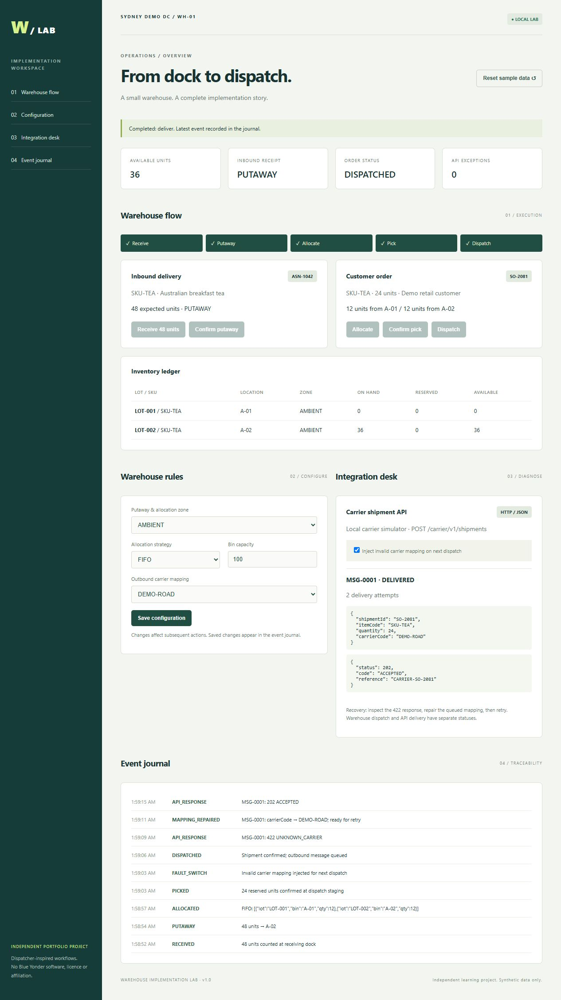

# Warehouse Implementation Lab

An independent, Dispatcher-inspired warehouse implementation lab for an Application Engineer portfolio. **This is not Blue Yonder Dispatcher or CargoWrite, does not use their code or interfaces, and does not demonstrate licensed proprietary hands-on experience.** No DSV affiliation. All customers, products, orders and carrier codes are synthetic.



Verified execution details: [verification record](docs/VERIFICATION.md). Portfolio and cover-letter wording: [portfolio explanation](docs/PORTFOLIO.md).

## Run locally

Install Node.js 22 or newer. From this folder:

```powershell
node server.mjs
```

Open http://127.0.0.1:4310. No package installation, database, account, API key, Socius24 or WiredMedium access is needed. Stop with Ctrl+C. Optional port: `$env:PORT=4311` before starting. Node stores the current warehouse in `data/state.json`; restarting retains it. The UI reset button restores the sample dataset and clears prior events. Copy that file before a reset if you want to retain evidence.

```powershell
node --test
```

## Five-minute demonstration

1. Show the independent-project notice and explain the requirements in `docs/IMPLEMENTATION.md`.
2. Receive ASN-1042 (48 units), then confirm putaway to A-02. Initial stock is 12 units in A-01.
3. Allocate SO-2081 (24 units). FIFO reserves 12 from each lot. Confirm pick: 36 units remain on hand, with zero reserved.
4. Enable **Inject invalid carrier mapping** before dispatch. Dispatch the order; inspect the outbound JSON.
5. Send to carrier. The actual local HTTP integration returns 422 / UNKNOWN_CARRIER, while the warehouse shipment stays DISPATCHED.
6. Inspect `carrierCode`, choose **Repair mapping**, then **Retry delivery**. The same message receives 202 / ACCEPTED on its second attempt. Show the event journal.
7. Reset, set bin capacity to 20, then receive and attempt putaway: capacity control rejects the move. Set it to 100 and retry. Reset and choose LIFO to demonstrate a different allocation.

## What is included

- Browser operations dashboard with inbound, putaway, lot-level stock, reservations, picking and dispatch.
- Configurable zone, FIFO/LIFO, bin capacity and carrier mapping; event trail for accepted changes.
- JSON shipment API mapping and an HTTP carrier simulator hosted locally.
- Reproducible carrier mapping incident, diagnostics and manual repair/retry.
- Automated FAT/SIT-style checks plus operations-led UAT scripts.
- Functional/technical design, RCA, controlled deployment checklist and honest portfolio language.

## Structure

`server.mjs` serves the UI and API. `src/lab.mjs` owns warehouse rules and transitions. `public/` contains the dashboard. `test/` contains automated scenarios. `docs/` holds project deliverables. `samples/` holds example mapped messages. `data/` is generated at runtime and excluded from version control.

## Scope and limits

This is a single-user local learning app. It binds to loopback. It has one SKU, one receipt, one order and fixed demo bins; inbound quantities are pre-seeded. It is not a general WMS, a real carrier integration, an EDI translator, or a recreation of proprietary screens. The carrier API is a contract simulator reached over HTTP, with no network dependency. State uses a JSON snapshot, not transactional storage. It has no authentication, multiple users, serial tracking, replenishment, expiry handling, production-grade audit retention or concurrency guarantees. Do not expose it publicly or enter real customer data. Simultaneous API submissions and crashes during writes are outside its supported use.

Use the documentation as a small implementation exercise, not as a claim that formal customer FAT/SIT/UAT or a production deployment has taken place. Automated tests do not establish operations sign-off.

